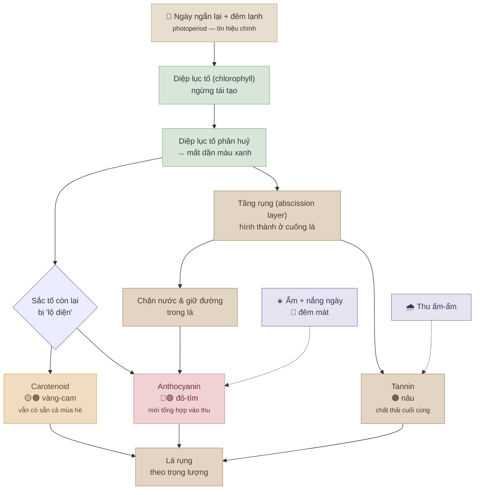

# Vì sao lá đổi màu mùa thu? — Sơ đồ logic

## Chuỗi nhân–quả (một câu)

> Đêm dài ra → cây ngưng tái tạo diệp lục tố → diệp lục tố tan dần để lộ carotenoid (vàng/cam) và
> kích hoạt tổng hợp anthocyanin (đỏ/tím, nhờ đường bị tầng rụng giữ lại) → tannin nâu xuất hiện cuối cùng →
> lá rụng theo trọng lượng.

## Nguồn

- Kew Gardens (RBG Kew) — *Why do leaves change colour in autumn?*
- Royal Society of Chemistry (RSC Education) — *The chemistry behind leaves changing colour*
- University of Missouri IPM — *The Science of Fall Leaf Color*
- PMC / Plant Physiology — *Why Leaves Turn Red in Autumn: the Role of Anthocyanins*
- American Journal of Botany (Primka & Smith, 2019) — synchrony in fall leaf drop
